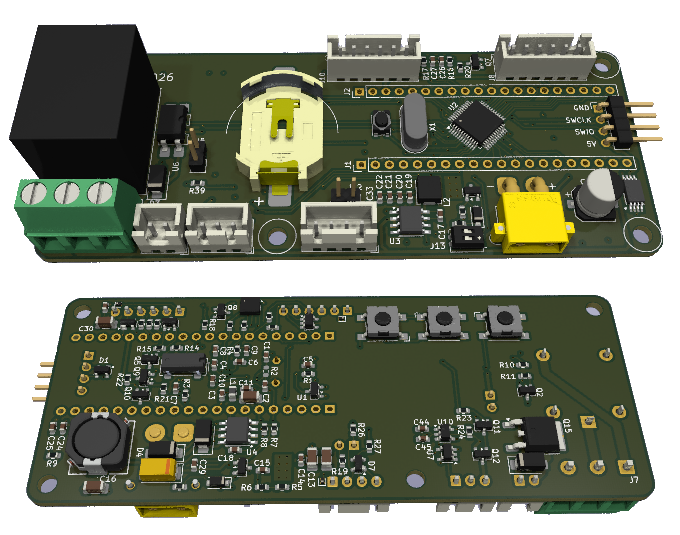
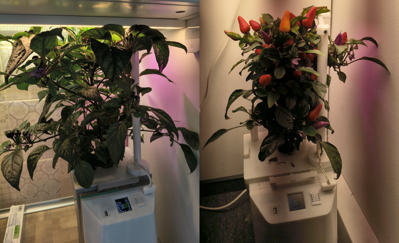
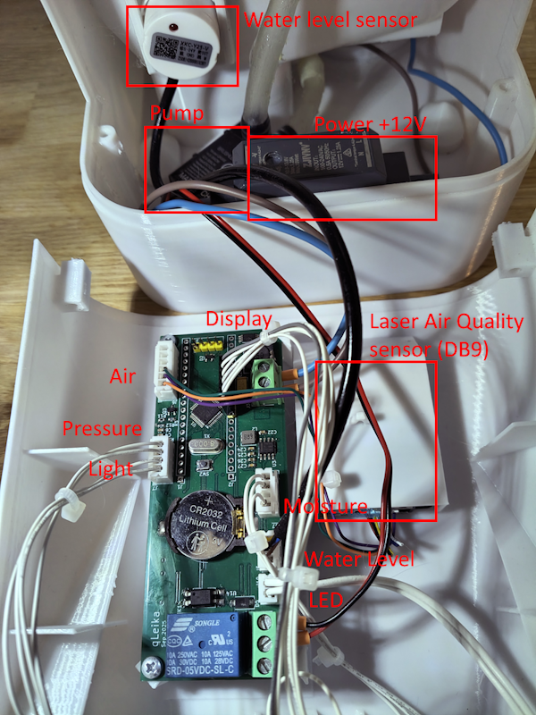

# Low power consumption Univresal Controller

I developed this universal carrier board to be a reliable, highly
protected platform for different kinds of automation and telemetry
applications. The main goal was to make a board that works perfectly
on battery or external power, while staying safe from real-world
electrical problems.

*Price*: 80 Euro

My main focus is to develop PCB with the characteristics:

- Automatic dual-power switching between 9-24V main power and 5V USB
without resetting the MCU or jumper.

- The high voltage section is completely separated from the
low-voltage schematic, so my main focus is provide a way to develop
and debug code safely using only 5V USB power with the display and
low-power sensors connected.

- Every external sensor and connected peripheral gets power through
a MOSFET, so the MCU can turn them completely off during sleep to save battery.

- Flexible on-board switches include 220V AC relay, one powerfull N-MOSFET
and several P-MOSFETs (supporting 3.3 and 5V) that can be used as the power
rails or as  independent PWM/Control lines for small pumps, motors and LEDs.

- 5V port for external sensor.

- Because external sensors often use long wires in noisy environments,
I implemented maximum EMC guards including TVS diodes, filters and
level buffers-on every single connector to protect the microcontroller
from static, noise, and voltage spikes.

## Example Application 'qLeika' device

This device is described below and it uses initial\version of the PCB.

| Sensor / Device | Interface / Protocol | Pin Function & Purpose |
| :--- | :--- | :--- |
| **Air Quality Sensor** (DB9) | USART1 | PA[9],PA[10]: Transmits serial telemetry and data readings (RXD/TXD). |
|                              | GPIO | PA[8]: Toggles pin high/low to enable or disable sensor power. |
|                              | PWM | PA[11]: Controls the speed of the internal intake fan. |
| **DHT22 Humidity**           | Single-Wire | PA[1]: Pulls data over a dedicated bi-directional digital pin. |
| **OLED Display**             | SPI1 | PB[5],PB[3]: Sends screen rendering commands and pixel data (SCK/MOSI). |
|                              | GPIO | PB[4]: Command/Data strob selector. |
|                              | GPIO | PA[15]: Drives the hardware Reset (RST) line. |
| **Pump relais**              | GPIO | PA[12]: Control relais pin. |
| **User Buttons**             | GPIO | PB[0],PB[1],PC[13]: Up, Center and Down buttons. |
| **VEML7700 Light sensor**    | I2C2 | PB[10],PB[11]: 400 kHz I2C interface. Address 0x20. |
| **BMP280 Pressure/Temperature** | I2C2 | PB[10],PB[11]: 400 kHz I2C interface. Address 0xEC. |
| **MOSFET LED**                   | TIM1 | PB[13]: PWM LED driver. |
| **XKC Y25 T12V** Liquide level sensor | GPIO | PB[15]: 5V tolerant buffer. |

## Assembeled device based on the PCB:

The following pictures show two different pepper varieties, 'Black Pearl' and 'Aurora',
grown in different locations.

The photo of 'Black Pearl' was taken at an early growth stage, when the plant had just started
producing its first peppers.

The photo of 'Aurora' was taken when the plant was approximately 10 months old and had already
produced an abundance of peppers.

## Board description

